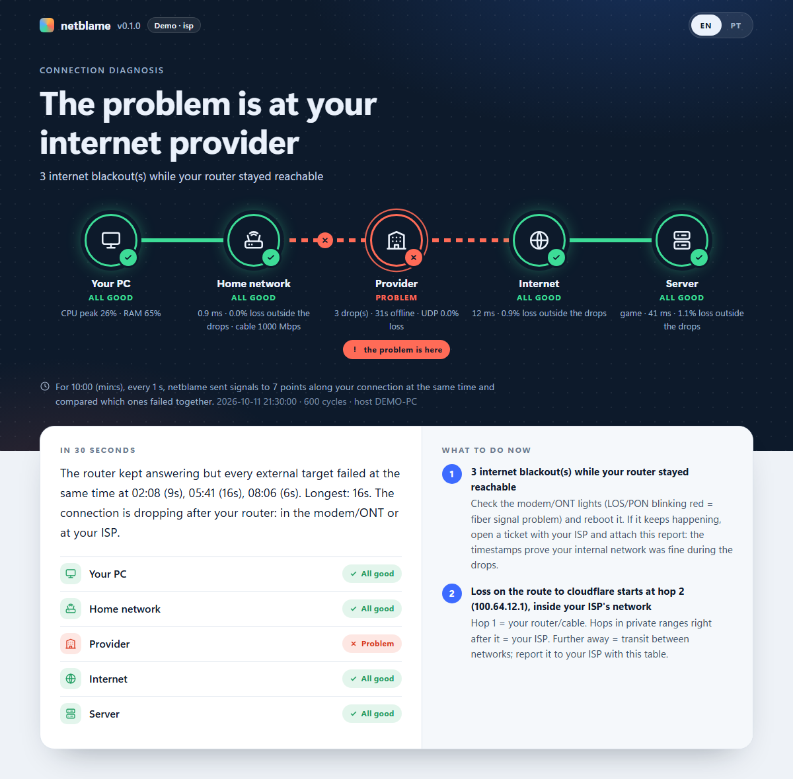

# netblame

[Versão em português](README.md)

**Find out _where_ your connection drops: your PC, your router, your ISP, or the route to the server.**

You're in the middle of a match, a call, or a remote session, and you get *"connection lost"* again.
Is it the cable? The router? The ISP? The game's servers? Usually there's no way to tell, so everyone
blames everyone else. netblame watches several points along the network path at the same time and
compares which ones fail together. That pattern tells you where the fault is.



*Report generated by `netblame demo --scenario isp` (synthetic data). Full HTML reports for every
scenario: [isp](docs/demo-isp.html) · [local](docs/demo-local.html) · [route](docs/demo-route.html) ·
[udp](docs/demo-udp.html) · [pc](docs/demo-pc.html) · [healthy](docs/demo-healthy.html). Download them
and open them in a browser.*

- Windows-first, **no admin rights**, **standard library only** (`psutil` optional)
- Works with any Windows display language. The parsers never match localized words.
- One self-contained HTML report: no CDN or internet needed to open it, and safe to attach to an ISP ticket
- **Bilingual: English and Brazilian Portuguese.** The report has an EN | PT switch, and both
  languages live in the same file. Whoever receives the report reads it in their own language.

## How it works

Each cycle (default: every second), all of these are probed **in parallel**:

| Probe | Default target | Answers |
|---|---|---|
| ICMP ping | your **gateway** (router, auto-detected) | Is my home network OK? |
| ICMP ping | `1.1.1.1` and `8.8.8.8` | Is the internet reachable at all? |
| DNS over **UDP** | the **same** `1.1.1.1` and `8.8.8.8` | Does the network treat UDP (what games use) worse than ping? |
| TCP connect | the **app** you care about (`--preset battlenet`, `--target game=tcp://host:port`) | Can I reach *this service*? |
| DNS query | your configured DNS server | Does name resolution work? |
| Per-hop ping | every hop of the traced route to the internet and to the app | Where on the route does loss start? |
| UDP counters | Windows (`GetUdpStatisticsEx`) | Did this PC drop UDP packets that did arrive? |
| psutil | CPU, RAM, throughput, NIC speed and error counters | Is it actually my PC? |

Then it reasons by elimination:

```
                     who failed in the same cycle?
                                  │
       ┌──────────────────────────┼──────────────────────────────┐
       │                          │                              │
 router AND everything     router OK, ALL external       only the app target
 external                  targets down                  is bad
       │                          │                              │
       ▼                          ▼                              ▼
   LOCAL problem            MODEM / ISP problem           ROUTE or SERVER problem
   cable · NIC · router     (blackout "upstream")         (outside your home)
       │                          │                              │
       └────────────┬─────────────┴──────────────┬───────────────┘
                    │                            │
        hop-by-hop: loss starts at hop N   ...and persists to the end → hop N is the culprit
                                           ...and vanishes after it  → ICMP rate-limit, ignore

 Cross-checks:  losses ⇔ CPU ≥ 90% / RAM ≥ 95%     → your PC, not the network
                UDP lost, ping to the same IP fine  → router/ISP mistreating UDP
                Windows discards incoming UDP       → PC can't keep up (CPU, antivirus, VPN)
                DNS fails, pings by IP work         → DNS server
                Ethernet at 100 Mbps, not 1000      → bad cable
                NIC error / drop counters grow      → cable or driver
                p95 > 4× median or jitter > 30 ms   → bufferbloat / ISP congestion
```

A few decisions worth explaining:

- **Why the OS `ping` and not raw sockets?** Raw ICMP needs administrator rights on Windows, and
  people don't want to run a diagnostic tool as admin. `ping.exe` needs no privileges. Its output is
  localized (`tempo=12ms` in pt-BR), so the parser only relies on structure: a reply line must
  contain `TTL=` and a `[=<]\s*\d+\s*ms` token. This also correctly rejects
  *"Destination host unreachable"*: Windows prints that as a "reply" and exits with code 0.
- **Why UDP to the same servers as the ping?** Games use UDP, and some routers (SIP ALG, flood
  protection) and ISPs handle UDP differently. A DNS query to `1.1.1.1` is real UDP to the **same
  destination** as the ping. If only UDP loses packets, the problem is how the protocol is treated,
  not the route.
- **Why ignore some hop loss?** Routers forward traffic in hardware but answer pings with spare CPU,
  and most rate-limit those answers. A hop showing 40% loss while the hops after it show 0% is
  fine. Only loss that starts at a hop *and continues to the destination* is real.
- **Why are hops pinged during the whole capture?** Drops are intermittent. A traceroute run after
  the problem is over shows a clean path. netblame traces the route once at the start, then pings
  every hop throughout the capture, so the hop statistics cover the same minutes as the blackouts.
- **Why a raw DNS query?** `getaddrinfo` is answered from the Windows DNS cache in ~0 ms and would
  hide a dead resolver. netblame builds the query with `struct` and sends it straight to the
  configured server, which is read from the registry (so it doesn't depend on the display language).
- **Why doesn't the gateway failing alone count as a blackout?** Many routers deprioritize pings
  addressed to themselves while forwarding traffic just fine. A "local" blackout requires the
  router **and** every external target to fail together.

## Install

Requires Python 3.10+.

```powershell
git clone https://github.com/vsalescode/netblame.git
cd netblame
pip install -e .            # standard library only
pip install -e .[system]    # + psutil: CPU/RAM, throughput, NIC speed and errors (recommended)
```

Or run without installing: `python -m netblame ...`

## Usage

```powershell
# 10-minute capture (default). Play / work normally while it runs.
netblame run --preset battlenet --process Overwatch.exe --open

# Any service: label=tcp://host:port for TCP, label=host for ICMP. Repeatable.
netblame run --minutes 30 --target game=tcp://my.game.server:443 --target nas=192.168.0.10

# Rebuild the report from a saved session (e.g. after upgrading netblame)
netblame report netblame-session-20261011-213000.json --open

# Synthetic, reproducible sessions: isp | local | route | udp | pc | healthy
netblame demo --scenario udp --open
```

Press **Ctrl+C** at any time. The capture stops cleanly and the report is still generated.

Language: `--lang en|pt` sets the terminal output and the report's initial language. By default it
follows the system language, and can be overridden with the `NETBLAME_LANG` environment variable.

Other useful options:
- `--interval`: seconds between cycles.
- `--hop-every N`: ping route hops every N cycles. The default is 2, because spawning many
  `ping.exe` per second costs a few % of CPU.
- `--dns-server`, `--no-trace`, `--no-dns`, `--no-udp`.
- Presets: `battlenet`, `steam`, `riot`, `epic`.

The output is a `.json` session (raw samples, so analysis can be re-run later) and a single `.html`
report.

## The report

Built to be understood by people who aren't network experts:

- **Path map** on the cover, drawn like a subway map: `Your PC → Home network → Provider → Internet →
  Server`. Each station is green, amber or red, the line is cut where the fault is, and a badge marks
  "the problem is here". The headline states the result in plain words, e.g. *"The problem is at your
  internet provider"*.
- **In 30 seconds**: the summary, a scoreboard of the 5 stops and a numbered list of what to do now
- **When the game dropped**: with `--process`, netblame notices when the game's CPU use collapses
  (match ended or dropped), shows the wall-clock time and how every point of the network was doing in
  the 5 seconds before. The moment is also marked on the timeline charts.
- **Key measurements** as lab-test style rulers: loss, latency, jitter and time offline, each with
  your value, the good/attention/bad bands and a "what is it?"
- **The path, stop by stop**: what each stop includes, what was found there and what to do
- **Timeline**, with a "how to read it" note on every chart:
  - latency per target, with lines broken on losses and blackouts shaded;
  - loss strip, one row per target;
  - PC load (CPU/RAM);
  - UDP vs ICMP.
  Hover (or focus and use ←/→) for a crosshair readout.
- **Technical details**, collapsible, for your ISP's support team: hop by hop (culprit highlighted),
  per-target statistics, blackouts and network adapters. Printing expands everything.
- **Glossary** of the words used in the report (latency, loss, jitter, hop, DNS, UDP...)
- **EN | PT switch**. The browser remembers the choice, and Portuguese uses decimal commas.
- Light/dark via `prefers-color-scheme`, a colorblind-safe Okabe-Ito palette on the charts, status
  always shown with an icon and text (never color alone), and a responsive layout: on phones the map
  becomes a vertical line.

## Limitations (please read)

- **netblame does not see the game's own UDP traffic.** The UDP probes go to public resolvers
  (1.1.1.1 and 8.8.8.8), not to your match server. They show whether the network treats UDP worse
  than ping, but a bad path to one specific game server only shows up through the app's TCP target
  and the hop table. Reading the game's real packets requires packet capture, which needs admin
  rights (see the roadmap). A clean capture is strong evidence, not proof. Run it *while* the
  problem happens, for longer.
- The app target checks reachability of the service's TCP front door (`battle.net:443`), not the
  specific match server you were on.
- Many providers intercept DNS (port 53). In that case the UDP test measures the provider's DNS
  server instead of the path to 1.1.1.1/8.8.8.8. netblame detects it (DNS much slower than a ping to
  the same IP) and says so in the report.
- "Game dropped" detection uses the process CPU: it can't tell a disconnect from a normal end of
  match, which is why the report says "ended or dropped".
- Windows' UDP counters cover the whole machine. They show *that* datagrams were discarded, not
  *which* program lost them.
- ICMP-based hop statistics are only as honest as the routers answering them. The rate-limit rule
  handles the common case, but a router that deprioritizes ICMP *and* has real loss can't be told
  apart from the outside.
- IPv4 only for now.
- Thresholds (1% loss, CPU 90%, p95 > 4× median, ...) are heuristics, defined as constants at the
  top of [`netblame/analysis.py`](netblame/analysis.py).

## Development

```powershell
pip install -e .[dev,system]
pytest
```

Parsing is separated from execution: pure functions, tested with real Windows output in pt-BR and
en-US. That's why the test suite runs on any OS. Every demo scenario has a test asserting the analysis
reaches the expected verdict.

```
netblame/
  models.py     dataclasses + JSON persistence (Session, Sample, SysSample, UdpSample, HopStat, ...)
  i18n.py       bilingual Text (en/pt), locale-aware number formatting, language detection
  probes.py     ping / TCP / raw DNS probes, locale-independent ping parser, UDP counters
  netinfo.py    gateway (route print), DNS servers (registry), physical NIC snapshot
  tracing.py    tracert parser, per-hop monitor, find_bad_hop / rate-limit detection
  sysmon.py     CPU, RAM, throughput, watched process (psutil)
  collector.py  the parallel capture loop
  analysis.py   statistics, blackout events, rules → findings → verdict
  demo.py       reproducible synthetic scenarios
  report.py     self-contained HTML/SVG report
  cli.py        run | report | demo
```

## Roadmap

- **Capture of the game's real traffic** (optional admin mode, via `pktmon`/ETW): discover the match
  server's IP, probe it directly and detect "silences" in the game's UDP flow
- **Notifications**: a desktop toast when a blackout starts, with its probable location
- **Session history**: compare captures across days and times to spot peak-hour ISP congestion
- IPv6 support

## License

MIT
